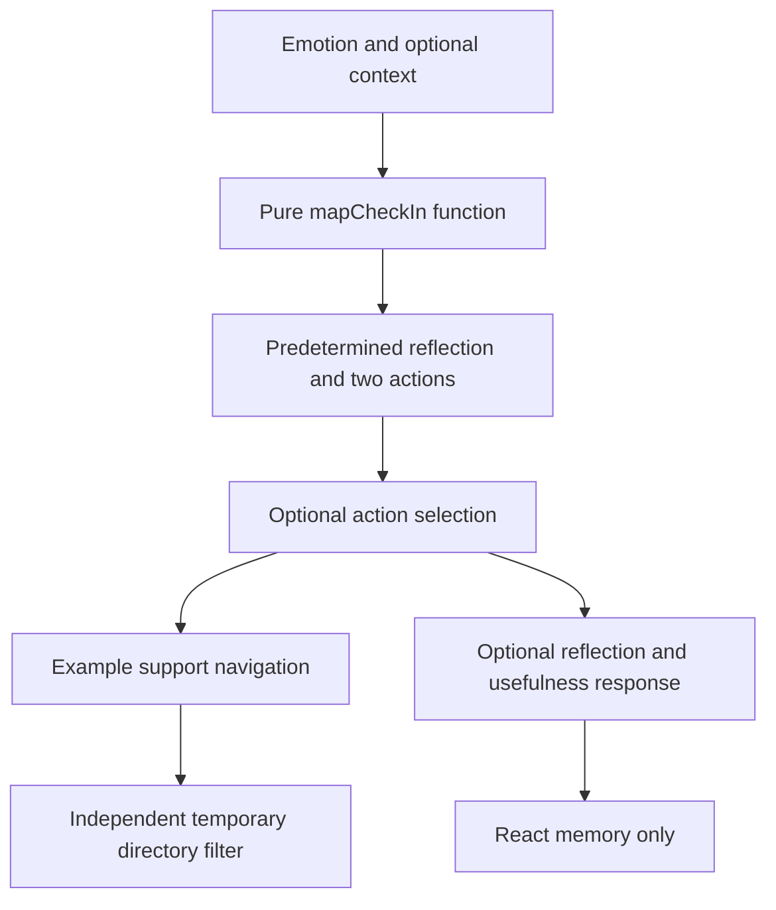

# Architecture

## Repository boundary

`prototype/` is an independent Next.js App Router application with strict TypeScript, React and Tailwind CSS. The root package and `src/` still belong to the original Vite app. Keeping both preserves earlier work while separating the approved Care Loop from legacy login, chatbot and booking screens. The Next.js app imports none of those screens.

## Components and routes

| Location | Responsibility |
| --- | --- |
| `prototype/app/layout.tsx` | Shared navigation, skip link, footer and metadata |
| `prototype/app/page.tsx` | Home route and Care Loop entry |
| `prototype/components/CareLoop.tsx` | Client interactions and temporary session state |
| `prototype/lib/content.ts` | Typed emotions, contexts, seven actions, six mock services and pure mapping rules |
| `prototype/app/support/page.tsx` | Example directory route |
| `prototype/components/SupportDirectory.tsx` | Temporary directory filter |
| `prototype/app/help/page.tsx` | Safety, emergency guidance and privacy explanation |
| `prototype/app/globals.css` | Responsive styles, visible focus and reduced-motion preference |

Next.js prerenders the pages; client components become interactive after hydration. No API routes, database connection, external model calls or background jobs are implemented.

## Care Loop data flow

Navigation to support is optional and can discard the home state. Returning home is not a guarantee of restoring prior entries. The stages are sections of one flow rather than a mandatory wizard; users can skip actions and reflection.

## Mapping algorithm

1. An emotion chooses a fixed reflection and two default action IDs.
2. When a context is present, its action ID is placed first.
3. Emotion defaults follow; a `Set` removes duplicate IDs while preserving order.
4. The first two unique IDs become suggestions.
5. A visible explanation describes the rule. Reflection text is never analyzed.

| Emotion | Default actions |
| --- | --- |
| Overwhelmed | Find your surroundings; Shrink the next task |
| Low | Put one thought on paper; Keep a little breathing room |
| Lonely | Make a small connection; Bring a little home closer |
| Okay | Keep a little breathing room; Put one thought on paper |
| Good | Keep a little breathing room; Make a small connection |

| Optional context | First suggestion |
| --- | --- |
| Study | Shrink the next task |
| Relationships | Make a small connection |
| Finances / Housing | Name one practical question |
| Homesickness | Bring a little home closer |
| General well-being | Keep a little breathing room |

The mapping is transparent product logic, not a clinical recommendation engine. TypeScript constrains supported inputs; the app offers no free-text classification.

## State and privacy

`useState` holds onboarding visibility, emotion, context, submitted state, selected action, note, usefulness response, routine count and the temporary confirmation. Routine count starts at one and allows one to three. The reflection button confirms existing memory state; it does not write to a persistence layer.

Reset returns home state to defaults. Clear reflection empties the note. A full reload clears component state. There are no application writes to cookies, localStorage, sessionStorage or a server. This is not encryption, secure erasure or protection against an observer of an open screen. Browser extensions and hosting infrastructure are outside the component-state guarantee.

Native radio controls, labels, fieldsets, landmarks, a skip link, visible focus and status messages support accessibility. Tests cover selected interactions; manual assistive-technology evaluation is still needed.
